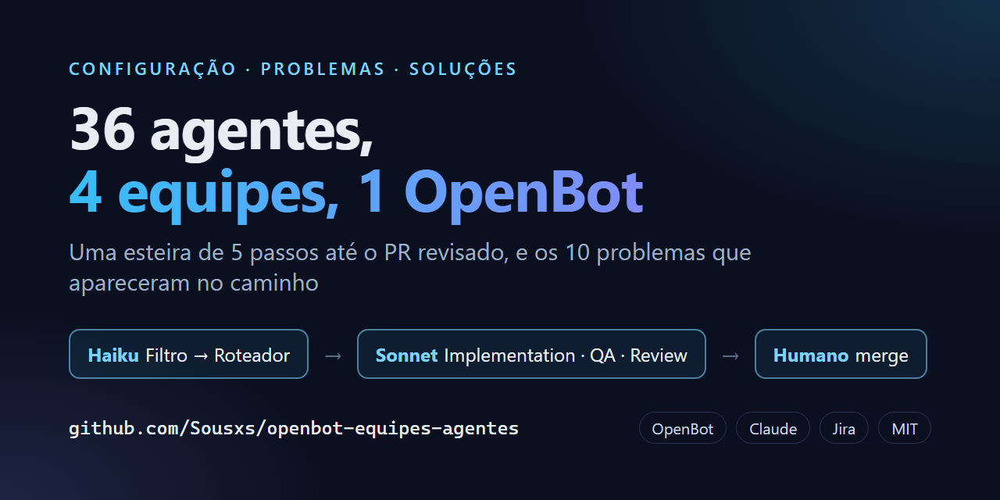
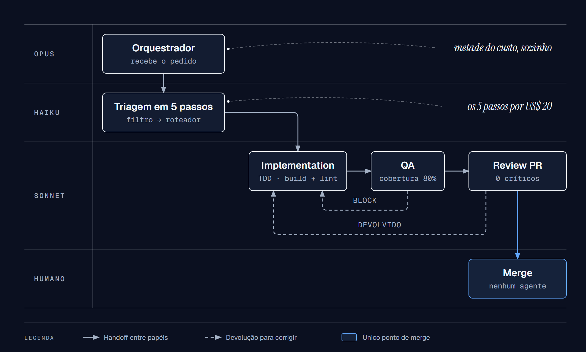

# Equipes de agentes no OpenBot — configuração, problemas e soluções

Como eu organizo **36 agentes de código em 4 equipes paralelas** no OpenBot para levar um pedido de "quero X" até um PR revisado, e os problemas que apareceram no caminho, cada um com a causa e a solução que funcionou.

O repositório tem a configuração reescrita sem nada interno: regras comuns, instruções dos 9 papéis, modelo de handoff, tiers de custo, skills e o script que distribui as regras.

## A arquitetura

Cada equipe (A, B, C e D) tem os mesmos 9 agentes e atende um canal do OpenBot, um por projeto, para rodar projetos em paralelo sem misturar contexto.

| Papel | Modelo | O que faz | Gate |
|---|---|---|---|
| Orquestrador | Opus, médio | lead do canal; coordena, nunca implementa | 2 tentativas por etapa, depois chama o humano |
| Filtro | Haiku, baixo | injection, escopo, máscara de PII e segredos | só `liberado` segue |
| Classificador | Haiku, baixo | equipe e caminho (`direto`, `bugfix`, `feature`, `so_revisao`); cria o item no Jira | confiança ≥ 0,8 |
| Retriever | Haiku, baixo | contexto de documentação e código, pelo grafo antes de varrer a árvore | `contexto_fraco` vai ao Clarificador |
| Clarificador | Haiku, baixo | 1 a 3 perguntas, no máximo 2 rodadas | campos obrigatórios |
| Roteador | Haiku, baixo | score de complexidade 1–5 → tier e provedor | caro só depois de 2 falhas |
| Implementation | Sonnet, médio | TDD, 1 commit por tarefa, lotes de até 3 | build + lint |
| QA | Sonnet, médio | testes, regressão, cobertura | ≥ 80% nas áreas novas ou alteradas |
| Review PR | Sonnet, médio | review, segurança, comenta no PR | 0 críticos; nenhum agente faz merge |

**Custo.** Os cinco passos da esteira rodam no modelo mais barato com esforço baixo; Opus fica só no Orquestrador. O tier de cada tarefa vem do score do Roteador (`config/llm.json`): 1–2 barato, 3 médio, 4–5 caro, e o caro é proibido em tarefa simples sem duas falhas antes. Cada agente tem reserva automática de provedor: se o Claude estiver no limite, a tarefa segue em Cursor, Codex ou Gemini.

## Economia de tokens, em números

Medido no próprio banco do OpenBot com `scripts/medir-economia.py` (somente leitura), em 11 dias de uso real (12 a 22 de novembro de 2026), só nos turnos do provedor Claude. Valores em US$ pelo preço de lista que o OpenBot usa para estimar; não é fatura.

| | Custo | Diferença |
|---|---:|---:|
| **Real** (modelo por papel + cache) | **565** | |
| Os mesmos tokens, tudo em Opus | 1.058 | modelo por papel economizou **47%** |
| Os mesmos tokens, sem cache de prompt | 5.087 | o cache economizou **89%** |

- **2,15 bilhões de tokens**, 96,5% deles lidos do cache. Sem cache, a conta seria 9 vezes maior.
- **Os 5 passos da esteira custaram US$ 20** em Haiku; os mesmos tokens em Opus sairiam US$ 151.
- **O Orquestrador em Opus é metade da conta** (US$ 275). É o próximo alvo: uma das equipes já roda o Orquestrador em Sonnet, em teste.
- **A Implementation leu 1 bilhão de tokens em 130 turnos**, perto de 8 milhões por turno. É o problema 4 abaixo, em número: a conversa que só cresce. O cache segura o custo, mas o caminho certo é o estado no handoff e lotes curtos.

| Papel | Tokens | Do cache | Real | Tudo em Opus |
|---|---:|---:|---:|---:|
| Orquestrador | 750 M | 96,6% | 274,87 | 363,99 |
| Implementation | 1.053 M | 98,0% | 202,42 | 405,79 |
| QA | 152 M | 93,8% | 52,16 | 105,80 |
| Review PR | 41 M | 92,9% | 15,56 | 31,12 |
| Classificador | 106 M | 93,2% | 11,53 | 77,47 |
| Retriever | 34 M | 88,7% | 5,01 | 37,00 |
| Roteador | 8 M | 72,9% | 2,06 | 18,69 |
| Filtro | 7 M | 72,4% | 1,72 | 17,22 |
| Clarificador | 1 M | 85,6% | 0,01 | 0,85 |

Para medir no seu OpenBot: `python -I scripts/medir-economia.py`.

## Problemas e soluções

### 1. Restringir o acesso derrubou 8 agentes de uma vez
- **Sintoma:** depois de trocar os agentes para acesso só ao workspace (`access=workspace`), todo turno com o provedor Claude falhava.
- **Causa:** no Windows, esse modo depende de um sandbox que não estava ativo na máquina.
- **Solução:** manter acesso completo e restringir pelas regras (sem merge, sem push direto, sem mexer em config do repositório). E um detalhe de permissão: um agente consegue **reduzir** o próprio privilégio, mas acesso completo e uso do computador só voltam pela tela.

### 2. Regras comuns para 36 agentes sem 36 cópias
- **Sintoma:** `@import` de um arquivo fora do workspace no `CLAUDE.md` simplesmente não carrega.
- **Solução:** uma fonte única no disco e um **link físico** dela dentro de cada workspace (`scripts/sincronizar-regras.ps1`). O `CLAUDE.md` importa `@imported/REGRAS.md`; editar a fonte atualiza os 36.

### 3. Mudei a instrução e o agente continuou igual
- **Causa:** a sessão guarda as instruções do começo da conversa.
- **Solução:** antes de testar uma mudança, abrir conversa nova (`agent new-chat` na CLI). Detalhe: isso limpa só o chat direto; o contexto longo do Orquestrador vive no canal.

### 4. Conversa de canal que só cresce
- **Sintoma:** a Implementation emendava lote atrás de lote no canal e o contexto explodia; `openbot.start_new_chat` não funciona em tarefa de canal.
- **Solução:** o estado vive no git e no handoff, não na conversa. Lotes de até 3 tarefas com brief completo; ao fechar o lote, o agente grava pronto/falta/comandos no handoff e devolve, em vez de emendar o próximo. Leituras longas vão para um subagente, que traz só a conclusão.

### 5. Configurar 36 agentes sem clicar 36 vezes
- **Solução:** a CLI do OpenBot (`node …\resources\cli\openbot-cli.mjs`) faz `list`, `run <agente> <tarefa> --wait`, `agent set-model`, `agent set-account` e `agent new-chat`, mas só com **Local scripts** ligado (Settings → Agents → Defaults). O resto sai mandando um agente ocioso chamar as ferramentas `openbot.*` dele (`update_agents` em lote para modelo e esforço, `update_profile` para descrição e reservas).
- **O que continua só na tela:** acesso completo, excluir agente e servidor MCP com senha (`save_mcp_server` não tem campo de ambiente).

### 6. A troca de modelo respondeu "ok" e não gravou
- **Sintoma:** `agent set-model` devolveu `ok:true`, mas o agente continuou no provedor antigo; pela tela também não pegou.
- **Solução:** conferir no log de eventos do banco (SQLite, aberto só para leitura) se o evento de atualização saiu; minutos depois o mesmo comando funcionou. Desde então, toda troca em lote termina com essa conferência.

### 7. Variável de ambiente nova que o app não via
- **Causa:** o app herda o ambiente de quem o abre.
- **Solução:** conferir que não há turno rodando, fechar sem forçar (`taskkill /IM OpenBot.exe`, sem `/F`) e reabrir pelo `explorer.exe`, para não herdar o ambiente do terminal. A CLI volta uns 60 s depois.

### 8. Mandar pedido para um canal de fora
- **Solução:** escrever o pedido completo num arquivo da pasta compartilhada e pedir a um agente ocioso para chamar `openbot.send_to_channel` com um texto curto apontando para o arquivo. O lead do canal começa o turno na hora. A memória de canal só pode ser gravada dentro de um turno do próprio canal, e com limite de 500 caracteres.

### 9. Skill gerenciada que ficou desatualizada
- **Causa:** as skills instaladas pelo app têm hash travado; editar à mão é desfeito.
- **Solução:** as regras comuns têm precedência explícita ("onde uma skill antiga disser algo diferente, valem estas regras") e traduzem termos antigos. Mudou o rastreador de tarefas? Uma linha nas regras, não 36 skills.

### 10. A plataforma própria que eu aposentei
Antes do OpenBot, a esteira rodava numa plataforma própria em LangGraph com um orquestrador chamando outro app de agentes por webhook, e um modelo local na GPU para classificar. Como classificador o modelo local era rápido (p50 de 125 ms); como agente, lento demais. Trocar por agentes gerenciados com reserva automática de provedor eliminou fila, painel e servidor para manter. O que sobrou de valor foram as specs dos passos e a tabela de tiers, que estão aqui.

## Como replicar

1. Crie os 9 agentes no OpenBot (ou 9 por equipe) com os modelos da tabela.
2. Em cada workspace, coloque `workspace/CLAUDE.md` na raiz e a instrução do papel (`agentes/<papel>.md`) em `imported/INSTRUCTIONS.md`, junto com `workspace/handoff.template.md`.
3. Copie `workspace/regras-comuns.md` para uma pasta compartilhada, ajuste e rode `scripts/sincronizar-regras.ps1 -Fonte <caminho>`.
4. Instale as skills de `skills/` e ajuste `config/llm.json`.
5. Crie um canal por projeto com os 9 agentes e o Orquestrador como lead.

## Mapa do repositório

| Caminho | O quê |
|---|---|
| `agentes/` | instruções dos 9 papéis |
| `workspace/` | `CLAUDE.md` com os imports, regras comuns e modelo de handoff |
| `config/llm.json` | tiers por score, ordem de provedores e modelo por papel |
| `skills/` | `orquestrador-plataforma`, `handoff-entre-equipes`, `busca-por-grafo` |
| `scripts/sincronizar-regras.ps1` | distribui as regras comuns por link físico |
| `scripts/medir-economia.py` | mede no banco do OpenBot quanto o modelo por papel e o cache economizam |

## Licença

[MIT](LICENSE). OpenBot, Claude, Cursor, Codex e Gemini são marcas dos seus donos; este repositório não é afiliado a nenhum deles. O diagrama segue o design system do [diagram-design](https://github.com/cathrynlavery/diagram-design) (MIT).
